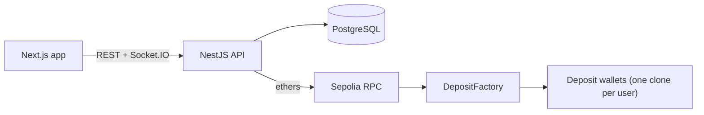
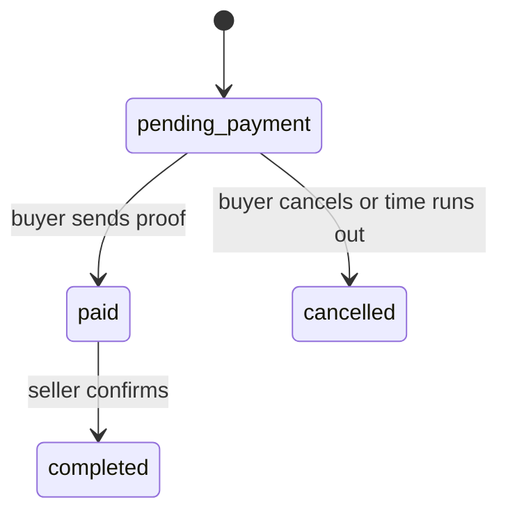
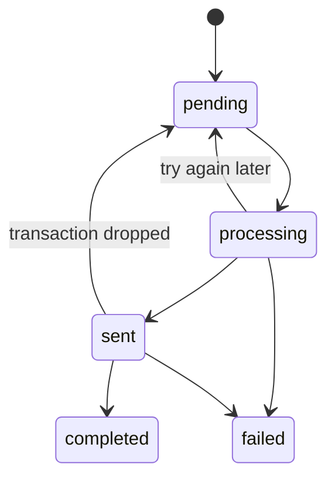

# P2P Crypto Exchange

A Binance-style peer-to-peer exchange that I built to understand how a custodial exchange works end to end: wallets, balances, escrow, and the boring parts in between that decide whether money is ever lost or counted twice.

It runs on the **Sepolia testnet** and only uses test ETH. The contracts have not been audited. Please do not point it at real funds.

## What you can do with it

- Register, log in and see your balance and transaction history.
- Get a personal deposit address per user and per network. Send test ETH to it and the balance is credited after a few confirmations.
- Post buy or sell ads, filter the market by payment method and available amount, and start an order from any ad.
- Chat with the other side of an order in real time, send the payment proof as an image or PDF, and let the seller confirm it.
- Withdraw ETH to your own wallet, with limits, a fee, and automatic recovery if a transaction gets stuck.

## How it fits together



Balances live in PostgreSQL. The chain is only used to receive money (deposits), to gather it in one place (sweeps) and to send it out (withdrawals). Everything in between, including the escrow of a trade, is bookkeeping in the database.

### Deposits

Every user has a deposit address, but no contract is deployed until it is needed.

1. `DepositFactory` creates minimal proxy clones with `CREATE2`. The salt comes from the user id, so the factory can compute the address of any user's wallet before it exists (`predict(userId)`).
2. The user sends ETH to that address. An address with no code can receive ETH just fine.
3. A background job reads new blocks, looks for transactions sent to one of our addresses, waits for the configured number of confirmations, and then records the deposit and credits the balance in a single database transaction.
4. A second job, the sweeper, moves the ETH from the user's address into the factory. The clone is deployed at that moment, at the address the user was already using.

### P2P trading

A sell ad locks the seller's crypto when it is created. When someone takes part of an ad, an order is created and that amount moves from the ad to the order. The buyer then has a limited time to pay outside the platform and upload proof.



When the seller confirms, the locked amount is released to the buyer's available balance. If a buy ad is used instead, the person who takes the ad is the seller and their crypto is locked at that point.

There is no dispute process. That was a deliberate scope decision, not an oversight.

### Chat

Each order has one conversation with the buyer and the seller as the only members. History is loaded over REST and new messages arrive over Socket.IO. Files are uploaded first and attached to a message afterwards, so a failed message can be retried without uploading again. The chat becomes read-only when the order is completed or cancelled.

### Withdrawals

A withdrawal request only moves the funds from `available` to `locked` and writes a row. A worker picks it up and calls `withdraw` on the factory, which pays from the ETH it holds. The withdrawal id is also passed to the contract, and the contract accepts each id once, so sending the same withdrawal twice cannot pay the user twice.



A failed withdrawal gives the locked funds back. A completed one consumes them.

## Tech stack

| Part      | What is used                                                                                    |
| --------- | ----------------------------------------------------------------------------------------------- |
| Front end | Next.js (App Router), React, Tailwind CSS, axios, zod, socket.io-client                         |
| Back end  | NestJS, TypeORM, PostgreSQL, Socket.IO, ethers v6, viem (unit conversion), class-validator, JWT |
| Contracts | Solidity 0.8.24, Foundry, OpenZeppelin (Clones, Ownable, SafeERC20)                             |
| Network   | Sepolia, through a public RPC endpoint                                                          |

## Repository layout

```
.
├── contract/           Foundry project
│   ├── src/            DepositFactory.sol, DepositWallet.sol
│   └── test/           Foundry tests
├── back-end/           NestJS API
│   └── src/
│       ├── auth/
│       ├── account/        profile, balances, merged transaction history
│       ├── ads/            ads and the market lists
│       ├── balances/       balance helpers (lock, unlock, settle)
│       ├── blockchain/     provider, factory contract, ABI
│       ├── chat/           conversations, messages, uploads, WebSocket gateway
│       ├── deposit/        address generation, block listener, sweeper
│       ├── orders/         orders and the order state machine
│       ├── payment-methods/
│       └── withdrawals/    requests, limits and the payment worker
└── front-end/          Next.js app
    └── app/
        ├── p2p/            market, order chat page and its components
        ├── deposit/
        ├── withdraw/
        ├── profile/        account page
        ├── components/     header, notifications bell
        └── lib/            axios instance, API helpers, socket
```

## Getting started

### Requirements

- Node.js 20 or newer
- PostgreSQL
- [Foundry](https://book.getfoundry.sh/getting-started/installation)
- A Sepolia RPC URL, a wallet with some Sepolia ETH for gas, and a second wallet address to use as the treasury

### 1. Contracts

```bash
cd contract
forge install OpenZeppelin/openzeppelin-contracts foundry-rs/forge-std
forge build
forge test
```

Deploy the factory. The constructor argument is the treasury address. `--interactive` asks for the private key so it does not end up in your shell history.

```bash
forge create src/DepositFactory.sol:DepositFactory \
  --constructor-args <TREASURY_ADDRESS> \
  --rpc-url <SEPOLIA_RPC> \
  --interactive \
  --broadcast
```

Copy the `Deployed to` address. Withdrawals are paid from the ETH held by the factory, so make the factory its own treasury:

```bash
cast send <FACTORY_ADDRESS> "setTreasury(address)" <FACTORY_ADDRESS> \
  --rpc-url <SEPOLIA_RPC> --interactive
```

Check that it answers:

```bash
cast call <FACTORY_ADDRESS> "predict(uint256)(address)" 1 --rpc-url <SEPOLIA_RPC>
```

> The deposit addresses depend on the factory address. If you deploy a new factory, every existing deposit address becomes invalid, so clear the old rows in `deposit_addresses` (in development) before using it.

### 2. Database

Create an empty database and put its name in the back-end `.env`. In development the back end lets TypeORM create the tables. The SQL for the tables added by each module is kept next to it if you prefer to create them by hand.

### 3. Back end

```bash
cd back-end
cp .env.example .env     # then fill it in
npm install
npm run start:dev
```

The API listens on `http://localhost:4000`.

### 4. Front end

```bash
cd front-end
npm install
npm run dev
```

Open `http://localhost:3000`. The back end allows that origin for the WebSocket; change it in `chat.gateway.ts` if you serve the app from somewhere else.

### 5. Try the whole flow

1. Register two users in two different browsers (or one normal and one private window).
2. Get Sepolia ETH from a faucet. On the deposit page, generate an address for user A and send some ETH to it. After the confirmations the balance goes up.
3. As user A, create a sell ad. The amount moves from available to locked.
4. As user B, open the market, press Buy on that ad, choose an amount and a payment method.
5. Both users are now in the order chat. User B uploads a screenshot with "I have paid".
6. User A presses "Confirm payment received". User B's balance goes up.
7. User B opens the withdraw page and sends the ETH to a wallet of their own.

## Configuration

Back end `.env`. Anything marked optional has the default shown.

| Variable                                                          | Default                 | What it does                                                                             |
| ----------------------------------------------------------------- | ----------------------- | ---------------------------------------------------------------------------------------- |
| `DB_HOST`, `DB_PORT`, `DB_USERNAME`, `DB_PASSWORD`, `DB_DATABASE` |                         | PostgreSQL connection                                                                    |
| `PORT`                                                            | `4000`                  | API port                                                                                 |
| `JWT_SECRET`                                                      |                         | Signs the access tokens. Also the fallback secret for file links                         |
| `SEPOLIA_RPC`                                                     |                         | RPC endpoint                                                                             |
| `SEPOLIA_CHAIN_ID`                                                | `11155111`              | Chain used for deposits and withdrawals                                                  |
| `FACTORY_ADDRESS`                                                 |                         | Address of the deployed `DepositFactory`                                                 |
| `OWNER_KEY`                                                       |                         | Private key of the factory owner. Signs sweeps and withdrawals. Treat it as a hot wallet |
| `ASSET_SYMBOL`, `ASSET_DECIMALS`                                  | `ETH`, `18`             | Asset shown in deposit records                                                           |
| `CONFIRMATIONS`                                                   | `2`                     | Blocks to wait before a deposit counts                                                   |
| `MAX_BLOCKS_PER_TICK`                                             | `50`                    | Blocks the deposit listener reads per run (every 15 s)                                   |
| `START_BLOCK`                                                     | latest block            | First block to scan on the very first run                                                |
| `SWEEP_ENABLED`                                                   | `false`                 | Turns the sweeper on                                                                     |
| `SWEEP_MIN_ETH`                                                   | `0.001`                 | Addresses holding less than this are skipped                                             |
| `SWEEP_GAS_MULTIPLIER`                                            | `3`                     | A sweep only runs if the balance is at least this many times its gas cost                |
| `SWEEP_MAX_PER_RUN`                                               | `10`                    | Sweeps sent per run (every 60 s)                                                         |
| `ORDER_PAYMENT_WINDOW_MINUTES`                                    | `15`                    | Time the buyer has to pay                                                                |
| `STORAGE_DIR`                                                     | `./storage`             | Where uploaded chat files are written                                                    |
| `PUBLIC_API_URL`                                                  | `http://localhost:4000` | Used to build signed download links                                                      |
| `FILE_URL_SECRET`                                                 | `JWT_SECRET`            | Secret for the signed download links                                                     |
| `WITHDRAWALS_ENABLED`                                             | `false`                 | Turns the withdrawal worker on. Nothing is sent without it                               |
| `WITHDRAW_MIN_ETH`, `WITHDRAW_MAX_ETH`                            | `0.001`, `1`            | Limits per withdrawal                                                                    |
| `WITHDRAW_DAILY_LIMIT_ETH`                                        | `2`                     | Per user, rolling 24 hours                                                               |
| `WITHDRAW_FEE_ETH`                                                | `0`                     | Charged on top of the amount                                                             |
| `WITHDRAW_MAX_OPEN`                                               | `3`                     | Unfinished withdrawals allowed per user                                                  |
| `WITHDRAW_STUCK_MINUTES`                                          | `10`                    | A transaction not mined after this long is sent again                                    |
| `WITHDRAW_MAX_ATTEMPTS`                                           | `5`                     | Reverts before a withdrawal is failed and refunded                                       |

## API

All routes except the public market lists and the file download need a `Authorization: Bearer <token>` header.

### Account

| Method | Path                            | Description                                                                    |
| ------ | ------------------------------- | ------------------------------------------------------------------------------ |
| POST   | `/auth/register`, `/auth/login` | Create an account, get a token                                                 |
| GET    | `/account`                      | Email, name and balances                                                       |
| GET    | `/account/transactions`         | Deposits, withdrawals and trades in one list. Query: `type`, `before`, `limit` |
| GET    | `/get-balance?asset=ETH`        | One balance                                                                    |

### Deposits

| Method | Path                            | Description                                         |
| ------ | ------------------------------- | --------------------------------------------------- |
| POST   | `/deposit`                      | Returns the deposit address for the user            |
| GET    | `/deposit/wait?address=&since=` | Long poll, up to 25 s, until a new deposit shows up |

### Market and orders

| Method | Path                     | Description                                                |
| ------ | ------------------------ | ---------------------------------------------------------- |
| GET    | `/ads/sell`, `/ads/buy`  | Public. Filters: `asset`, `paymentMethod`, `minRemaining`  |
| GET    | `/ads/:id`               | One of your own ads                                        |
| POST   | `/ads`                   | Create an ad                                               |
| PATCH  | `/ads/:id`               | Change price, limits, status or the total                  |
| DELETE | `/ads/:id`               | Delete an ad and release what is left of its locked amount |
| POST   | `/ads/:adId/orders`      | Start an order: `{ amount, paymentMethodId }`              |
| GET    | `/orders`, `/orders/:id` | Your orders                                                |
| POST   | `/orders/:id/pay`        | Buyer: send the proof, `{ uploadIds, note? }`              |
| POST   | `/orders/:id/confirm`    | Seller: release the crypto                                 |
| POST   | `/orders/:id/cancel`     | Buyer: cancel before paying                                |

### Chat

| Method | Path                               | Description                                                |
| ------ | ---------------------------------- | ---------------------------------------------------------- |
| GET    | `/chat/conversations`              | Your conversations with the last message and unread count  |
| GET    | `/chat/conversations/:id/messages` | `before=<id>` for older messages, `after=<id>` to catch up |
| POST   | `/chat/conversations/:id/messages` | `{ content?, attachmentIds?, clientMessageId? }`           |
| POST   | `/chat/conversations/:id/uploads`  | multipart, field `file`                                    |
| POST   | `/chat/conversations/:id/read`     | `{ lastReadMessageId }`                                    |
| GET    | `/chat/unread`                     | Total and per-conversation unread counts                   |
| GET    | `/chat/attachments/:id/url`        | Short-lived signed link to a file                          |

### Withdrawals

| Method | Path                               | Description                                           |
| ------ | ---------------------------------- | ----------------------------------------------------- |
| GET    | `/withdrawals/limits`              | Min, max, fee and how much of the daily limit is left |
| POST   | `/withdrawals`                     | `{ address, amount, clientRequestId? }`               |
| GET    | `/withdrawals`, `/withdrawals/:id` | Your withdrawals                                      |

### WebSocket

Connect to the `/chat` namespace and pass the token: `io("http://localhost:4000/chat", { auth: { token } })`.

| Event                                     | Direction            | Payload                                                         |
| ----------------------------------------- | -------------------- | --------------------------------------------------------------- |
| `conversation:join`, `conversation:leave` | client to server     | `{ conversationId }`                                            |
| `message:send`                            | client to server     | `{ conversationId, content?, attachmentIds?, clientMessageId }` |
| `conversation:read`                       | client to server     | `{ conversationId, lastReadMessageId }`                         |
| `message:new`                             | server to room       | the saved message                                               |
| `message:failed`                          | server to sender     | `{ conversationId, clientMessageId, error }`                    |
| `conversation:unread_updated`             | server to user       | `{ conversationId, unreadCount, totalUnread }`                  |
| `conversation:created`                    | server to user       | `{ conversationId, orderId }`                                   |
| `order:updated`                           | server to both users | `{ orderId, conversationId, status }`                           |

## Data model

| Table                                                                                                       | Purpose                                                                     |
| ----------------------------------------------------------------------------------------------------------- | --------------------------------------------------------------------------- |
| `users`, `payment_methods`                                                                                  | Accounts and the payment methods an ad can offer                            |
| `balances`                                                                                                  | `available` and `locked` per user and asset, `numeric(38,18)`               |
| `deposit_addresses`, `deposits`, `chain_cursors`                                                            | Addresses, recorded deposits, and the last block the listener has processed |
| `sweeps`                                                                                                    | Every sweep that was sent, with the amount and transaction hash             |
| `ads`, `ad_payment_methods`                                                                                 | Market ads and their payment methods                                        |
| `orders`                                                                                                    | One row per trade, with the amount, price and status                        |
| `chat_conversations`, `chat_messages`, `chat_message_attachments`, `chat_participant_reads`, `chat_uploads` | Chat                                                                        |
| `withdrawals`                                                                                               | Withdrawal requests and their state                                         |

## Design notes

**Money is never a JavaScript number.** Amounts are strings in the API, `numeric(38,18)` in PostgreSQL and `bigint` with 18 decimals inside the services. Floating point has no place in a balance.

**Balance changes are single statements.** Locking funds is `UPDATE balances SET available = available - x, locked = locked + x WHERE ... AND available >= x`. The check and the change happen together, so two requests that arrive at the same moment cannot spend the same balance twice, and the code never reads a balance just to compare it.

**Lock order is fixed.** Anything that touches several rows takes the locks in the same order (order, then ad, then balances), which keeps concurrent requests from deadlocking each other.

**Everything that can be retried has an idempotency key.** Chat messages carry a `clientMessageId`, withdrawal requests a `clientRequestId`, and each withdrawal has an id that the contract accepts only once. A double click, a timeout or a restarted worker does not turn into a second message or a second payment.

**Deposits are found by reading blocks, with a stored cursor.** The listener remembers the last block it finished in the database. After a restart it continues from there instead of missing whatever happened while it was down. A unique key on the transaction hash makes processing the same block twice harmless.

**The worker repairs itself.** If the process dies between sending a withdrawal and saving its hash, if a transaction is dropped from the mempool, or if the owner wallet runs out of gas, the next run asks the contract whether the id was already paid and either finishes the withdrawal or sends it again. Problems on our side (no gas, node down, empty pool) never fail a user's withdrawal.

**The chat keeps what was said.** Messages cannot be edited or deleted, because they are the only record of a trade. Files are checked by their first bytes rather than by the extension or the mime type the client claims, and they are served through links that expire after five minutes.

## Security notes

- The owner key signs sweeps and withdrawals and can move everything held by the factory. In this project it sits in an environment variable. Anything beyond a testnet needs it in a KMS or HSM, a separate low-privilege role for sweeping, and a multisig as the treasury.
- Sweeps and withdrawals are off until you set `SWEEP_ENABLED` and `WITHDRAWALS_ENABLED`.
- Withdrawals have a minimum, a maximum, a rolling daily limit and a cap on how many can be open at once.
- Tokens are JWTs stored in `localStorage`, and logging out only removes the token on the client. They stay valid until they expire.
- Rate limits in the chat are kept in memory, so they are per process.
- The contracts are small, but they have not been reviewed by anyone else.

## Known limitations

- ETH only. The contracts can sweep and pay out ERC-20 tokens, but deposit detection and withdrawals in the back end handle ETH.
- ETH sent from a smart contract (a Safe, for example) arrives as an internal transaction and is not detected as a deposit.
- There are no disputes, no KYC and no two-factor login.
- Balance movements are not written to a ledger table yet.
- Uploaded files are stored on local disk. The storage service has four methods, so S3 is a small change.
- A single API instance is assumed. Running several would need a Redis adapter for Socket.IO and shared rate limits.
- Back-end and front-end tests are still to be written.

## Roadmap

- ERC-20 deposits and withdrawals (USDT first)
- A ledger table for every balance movement
- Manual review for large withdrawals
- Dispute handling and an admin view
- Session revocation on logout
- Push notifications and email

## Testing

The contract tests use Foundry:

```bash
cd contract
forge test -vv
```

They cover address prediction, sweeping before and after a wallet is deployed, access control, and the withdrawal rules (paying twice with the same id, a recipient that rejects ETH, and retrying after a failed payment).

# Contact me

Linkedin: https://www.linkedin.com/in/abdalrhman-walid
Email: dev.abdalrhman.walid@gmail.com
X: https://x.com/booody_walid
